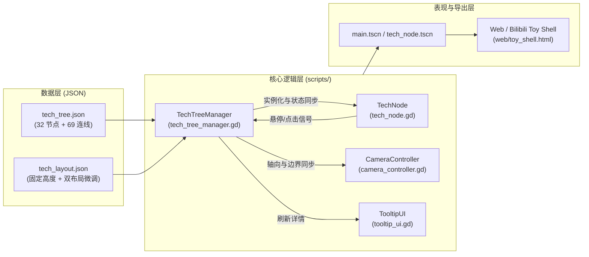

# 技术架构与数据规范 (Technical Architecture & Data Schema)

## 一、 系统架构概览

本项目基于 **Godot 4.7 (GL Compatibility)** 构建，采用数据驱动（Data-Driven）架构，将**科学史有向无环图数据**、**三维空间点位避让配置**与**3D 渲染/交互控制**解耦。

---

## 二、 核心模块职责

| 脚本 / 文件 | 核心职责 |
| :--- | :--- |
| [`scripts/tech_tree_manager.gd`](../scripts/tech_tree_manager.gd) | 解析 `tech_tree.json` 与 `tech_layout.json`；计算纵向/横向立体圆盘坐标；生成 32 个 `TechNode` 实例与 69 条 `CylinderMesh` 动态连线；管理科技点累加、前置条件校验、0.8 秒布局切换补间动画及触屏/桌面 UI 按钮。 |
| [`scripts/tech_node.gd`](../scripts/tech_node.gd) | 单个科技节点的材质状态机（锁定/可解锁/已解锁）、自发光与 `Label3D` 描边文本渲染、碰撞拾取区域（`Area3D`）及解锁脉冲缩放动画。 |
| [`scripts/camera_controller.gd`](../scripts/camera_controller.gd) | 实现固定中轴线（Y 轴 / X 轴）相机系统；处理 6 像素阈值点击/拖动仲裁、绕轴 360° 极点连续旋转、画面跟随鼠标平移、自动全景视距计算与滚轮/按钮缩放。 |
| [`scripts/tooltip_ui.gd`](../scripts/tooltip_ui.gd) | 鼠标悬停与触屏浮动详情面板，自动进行视口边界防溢出裁剪（Clamp），并设置 `MOUSE_FILTER_IGNORE` 防止遮挡 3D 射线拾取。 |

---

## 三、 数据结构规范

### 1. 科技树图谱数据 ([`tech_tree.json`](../tech_tree.json) / [`tech_tree_en.json`](../tech_tree_en.json))

* **`eras`** (`Array`): 5 个历史演进世代（`tier: 0 ~ 4`），对应圆盘所在的轴向分层。
* **`domains`** (`Array`): 5 大科学领域及其十六进制主题色（`#3B82F6`、`#F59E0B`、`#10B981`、`#EF4444`、`#8B5CF6`）。
* **`nodes`** (`Array`, 32 项):
  * `id` (`String`): 节点唯一标识符
  * `name` (`String`): 学科名称（中/英一一对应）
  * `tier` (`int`): 所属层级 (`0 ~ 4`)
  * `era` (`String`): 对应历史时期 ID
  * `domain` (`String`): 所属学科领域 ID
  * `representatives` (`Array[String]`): 代表科学家/先驱
  * `key_elements` (`Array[String]`): 关键理论、定律或实验仪器
  * `description` (`String`): 学科历史演进定位描述
* **`links`** (`Array`, 68 项基础演进 + 运行时连通保障):
  * `source` (`String`): 前序学科节点 `id`
  * `target` (`String`): 后继学科节点 `id`
  * `type` (`String`): 连线性质——`core`（本学科核心继承）、`cross_tool`（跨学科工具/仪器赋能）、`cross_method`（跨学科范式/数学方法迁移）
  * `relation` (`String`): 具体交叉赋能逻辑说明

### 2. 点位避让配置 ([`tech_layout.json`](../tech_layout.json))

为防止 3D 空间中的长跨度连线穿过无关节点，[`tech_layout.json`](../tech_layout.json) 固化了每个节点的：
* `height_offset`: 圆盘法向立体起伏高度（在 `[-1.5, 1.5]` 范围内固定，消除随机重启导致的穿模）。
* `vertical_offset` / `horizontal_offset`: 纵向与横向两种布局下的微调位移向量（附加位移不超过 3 个世界单位），确保全部 2,070 对“节点-无关连线”空间距离 $\ge 1.33$ 单位。

---

## 四、 自动化回归测试套件 (`tests/`)

项目配备 8 组无头（Headless）自动化测试脚本，共计 **2,122 项断言检查**：

| 测试脚本 | 检查项数 | 验证内容 |
| :--- | :---: | :--- |
| [`tests/test_interactions.gd`](../tests/test_interactions.gd) | 35 | 双向滚轮缩放、相机极值边界、实际视口点击、点数与提示框状态刷新 |
| [`tests/test_layout_modes.gd`](../tests/test_layout_modes.gd) | 48 | 纵向/横向双方向布局坐标、0.8s 切换动画、69 条连线端点逐帧同步 |
| [`tests/test_prerequisite_unlocks.gd`](../tests/test_prerequisite_unlocks.gd) | 258 × 2 | 横向与纵向模式下通过真实视口鼠标事件逐步解锁全部 32 个节点 |
| [`tests/test_drag_release.gd`](../tests/test_drag_release.gd) | 23 | 原地单击购买、拖动取消购买、失焦/Esc/切布局取消、防重复扣点 |
| [`tests/test_fixed_axis.gd`](../tests/test_fixed_axis.gd) | 56 | 固定中轴旋转、30° 默认观察角、极点连续性、内容跟随鼠标平移、开局全景可见性 |
| [`tests/test_drag_sampling.gd`](../tests/test_drag_sampling.gd) | 11 | 单次大步长拖动与 20 次细分事件拖动的结果一致性、6 像素防抖阈值 |
| [`tests/test_point_clearance.gd`](../tests/test_point_clearance.gd) | 1,433 | 32 节点与 69 连线在多随机种子、重启、往返切换下的空间距离与默认视角投影留白 |
