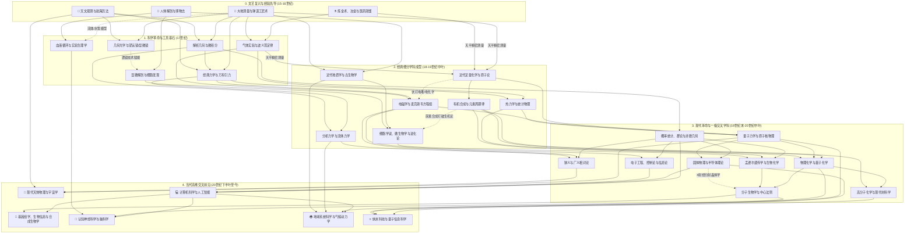

# 人类近代科学交叉科技树 (DAG)

人类近代科学并非单线树状演进，而是一张由**先导经验/技艺**（天文、测量、炼金、解剖）不断碰撞、借用工具与融合范式所织成的**有向无环交叉网络（DAG, Directed Acyclic Graph）**。

---

## 一、 全景交叉拓扑图 (Mermaid)

> **图例说明**：
> - `实线箭头 (-->)`：核心理论继承 / 直接学科衍生 (`core`)
> - `虚线箭头 (-.->)`：工具赋能 (`cross_tool`) 或 跨学科方法论迁移 (`cross_method`)

---

## 二、 学科交叉的世代演进矩阵

| 演进世代 | 核心驱动力 | 代表性交叉公式（前序学科 $\times$ 赋能学科 $=$ 新生细分学科） |
| :--- | :--- | :--- |
| **第一代 (17世纪)** 数学与仪器化 | 测量定量化、光学仪器 | • 天文观测 $\times$ 弹道测量 $\times$ 微积分 $=$ **经典力学** • 磨镜工艺 $\times$ 人体/植物解剖 $=$ **显微解剖学 / 细胞发现** • 机械水泵模型 $\times$ 血管解剖 $=$ **近代实验生理学** |
| **第二代 (18-19世纪)** 能量与微观单元 | 工业动力、精密天平、电流 | • 炼金蒸馏术 $\times$ 精密天平测量 $=$ **近代定量化学 (原子论)** • 蒸汽机工匠测量 $\times$ 气体化学 $\times$ 统计数学 $=$ **热力学与统计物理** • 金属酸碱化学 $\times$ 磁学测量 $=$ **电化学 $\rightarrow$ 电磁学** • 地层测量 $\times$ 比较解剖学(化石) $=$ **古生物学与进化论** |
| **第三代 (20世纪上半叶)** 量子与分子还原 | 原子结构、X射线、电子管 | • 经典化学 $\times$ 热力学 $\times$ 量子力学 $=$ **物理化学 / 量子化学** • 电磁学 $\times$ 固体量子物理 $\times$ 数理逻辑 $=$ **半导体与电子计算机** • 遗传学 $\times$ 有机化学 $\times$ X射线晶体物理 $=$ **分子生物学** |
| **第四代 (20世纪下半叶至今)** 信息与复杂系统 | 算力、基因测序、高维非线性 | • 分子生物学 $\times$ 计算机算法 $\times$ 统计学 $=$ **生物信息学 / 基因组学** • 解剖神经学 $\times$ 电生理 $\times$ 计算机AI $=$ **认知与计算神经科学** • 广义相对论 $\times$ 粒子物理 $\times$ 天文观测 $=$ **现代天体物理与宇宙学** • 流体力学 $\times$ 地球化学 $\times$ 超算模拟 $=$ **地球系统与气候科学** |
