# Cross-Disciplinary Technology Tree of Modern Science (DAG)

Modern human science did not evolve along a single linear tree; rather, it is a **Directed Acyclic Graph (DAG)** woven from the continuous collision, tool-borrowing, and paradigm fusion of **empirical precursors and crafts** (Astronomy, Surveying, Alchemy, and Anatomy).

---

## I. Panoramic Cross-Disciplinary Topology (Mermaid)

> **Legend**:
> - `Solid Arrow (-->)`: Core theoretical inheritance / direct disciplinary derivation (`core`)
> - `Dashed Arrow (-.->)`: Instrumental empowerment (`cross_tool`) or cross-disciplinary methodological migration (`cross_method`)

```mermaid
flowchart TD
    %% ================= Tier 0: Four Classical & Empirical Precursors =================
    subgraph T0 ["0. Renaissance & Empirical Precursors (15th-16th Century)"]
        A0["🔭 Astronomical Observation & Navigational Calendrics"]
        B0["📏 Geodetic Surveying & Ballistic Craftsmanship"]
        C0["⚗️ Alchemy, Metallurgy & Iatrochemical Distillation"]
        D0["🦴 Human Anatomy & Natural History"]
    end

    %% ================= Tier 1: First Scientific Revolution (Instruments & Mathematization) =================
    subgraph T1 ["1. Scientific Revolution & Instrumental Foundations (17th Century)"]
        B1["Analytic Geometry & Calculus"]
        A1["Geometric Optics & Telescope/Microscope"]
        A2["Classical Mechanics & Universal Gravitation"]
        C1["Pneumatic Experiments & Boyle's Law"]
        D1["Blood Circulation & Experimental Physiology"]
        D2["Microscopic Anatomy & Discovery of the Cell"]
    end

    %% T0 -> T1 Cross-Links
    A0 & B0 --> B1
    A0 & B0 --> A1
    A0 & B1 & B0 --> A2
    B0 & C0 --> C1
    A1 -.->|"Lens Technology Empowerment"| D2
    D0 --> D1 & D2
    B0 -.->|"Fluid / Water-Pump Model"| D1

    %% ================= Tier 2: Formation of Classical Disciplines & Industrial Revolution =================
    subgraph T2 ["2. Formation of Classical Sub-disciplines (18th-Mid-19th Century)"]
        M1["Analytical Mechanics & Fluid Mechanics"]
        P1["Thermodynamics & Statistical Physics"]
        P2["Electromagnetism & Maxwell's Equations"]
        C2["Modern Quantitative Chemistry & Atomic Theory"]
        C3["Organic Synthesis & Periodic Law of Elements"]
        G1["Modern Geology & Paleontology"]
        D3["Cell Theory, Microbiology & Theory of Evolution"]
    end

    %% T1 -> T2 Cross-Links
    B1 & A2 --> M1
    A2 & C1 --> P1
    C0 & C1 & B0 -->|"Precision Balance Measurement"| C2
    C2 --> C3
    C1 & A2 --> P2
    C2 -.->|"Voltaic Pile / Electrochemistry"| P2
    B0 & D0 --> G1
    D2 & G1 --> D3
    C3 -.->|"Urea Synthesis Overthrows Vitalism"| D3

    %% ================= Tier 3: 20th-Century Physics Revolution & Grand Convergence =================
    subgraph T3 ["3. Modern Revolution & Primary Interdisciplines (Late 19th-Mid-20th Century)"]
        M2["Probability, Statistics, Group Theory & Non-Euclidean Geometry"]
        P3["Special & General Relativity"]
        P4["Quantum Mechanics & Nuclear Physics"]
        P5["Solid-State Physics & Semiconductor Theory"]
        C4["Physical Chemistry & Quantum Chemistry"]
        C5["Polymer Chemistry & Modern Materials Science"]
        B2["Mendelian Genetics & Biochemistry"]
        B3["Molecular Biology & The Central Dogma"]
        E1["Electronic Engineering, Cybernetics & Information Theory"]
    end

    %% T2 -> T3 Cross-Links
    B1 --> M2
    M1 & P2 & M2 --> P3
    P1 & P2 & C2 --> P4
    P4 & M2 --> P5
    P1 & P4 & C3 --> C4
    C3 & C4 --> C5
    D3 & C3 & M2 --> B2
    P5 -.->|"X-Ray Diffraction Crystallography"| B3
    B2 & C4 --> B3
    P2 & M2 --> E1

    %% ================= Tier 4: Contemporary High-Dimensional Interdisciplinary Frontiers =================
    subgraph T4 ["4. Contemporary High-Dimensional Interdisciplinary Frontiers (Late 20th Century-Present)"]
        F1["🌌 Modern Astrophysics & Cosmology"]
        F2["💻 Computer Science & Artificial Intelligence"]
        F3["🧬 Genomics, Bioinformatics & Synthetic Biology"]
        F4["🧠 Cognitive Neuroscience & Brain Science"]
        F5["🌍 Earth System Science & Climate Dynamics"]
        F6["⚛️ Nanotechnology & Quantum Information Science"]
    end

    %% T3 -> T4 Cross-Links
    P3 & P4 & A0 --> F1
    E1 & P5 & M2 --> F2
    B3 & F2 --> F3
    D1 & B3 & F2 --> F4
    G1 & M1 & C4 & F2 --> F5
    P4 & P5 & C5 --> F6
```

---

## II. Evolutionary Matrix of Interdisciplinary Generations

| Generation | Core Driving Force | Representative Cross-Disciplinary Formula (Precursor $\times$ Enabling Discipline $=$ Emergent Sub-discipline) |
| :--- | :--- | :--- |
| **Gen 1 (17th Century)** Mathematization & Instrumentation | Quantitative Measurement, Optical Instruments | • Astronomical Observation $\times$ Ballistic Surveying $\times$ Calculus $=$ **Classical Mechanics** • Lens Grinding Craft $\times$ Human/Plant Anatomy $=$ **Microscopic Anatomy / Cell Discovery** • Mechanical Water-Pump Model $\times$ Vascular Anatomy $=$ **Modern Experimental Physiology** |
| **Gen 2 (18th–19th Century)** Energy & Microscopic Units | Industrial Power, Precision Balance, Electric Current | • Alchemical Distillation $\times$ Precision Balance Measurement $=$ **Modern Quantitative Chemistry (Atomic Theory)** • Steam Engine Surveying $\times$ Pneumatic Chemistry $\times$ Statistical Math $=$ **Thermodynamics & Statistical Physics** • Metal/Acid-Base Chemistry $\times$ Magnetic Measurement $=$ **Electrochemistry $\rightarrow$ Electromagnetism** • Stratigraphic Surveying $\times$ Comparative Anatomy (Fossils) $=$ **Paleontology & Theory of Evolution** |
| **Gen 3 (First Half of 20th Century)** Quantum & Molecular Reduction | Atomic Structure, X-Rays, Vacuum Tubes | • Classical Chemistry $\times$ Thermodynamics $\times$ Quantum Mechanics $=$ **Physical Chemistry / Quantum Chemistry** • Electromagnetism $\times$ Solid-State Quantum Physics $\times$ Mathematical Logic $=$ **Semiconductors & Electronic Computers** • Genetics $\times$ Organic Chemistry $\times$ X-Ray Crystal Physics $=$ **Molecular Biology** |
| **Gen 4 (Late 20th Century–Present)** Information & Complex Systems | Computing Power, Gene Sequencing, High-Dimensional Nonlinearity | • Molecular Biology $\times$ Computer Algorithms $\times$ Statistics $=$ **Bioinformatics / Genomics** • Anatomical Neurology $\times$ Electrophysiology $\times$ Computer AI $=$ **Cognitive & Computational Neuroscience** • General Relativity $\times$ Particle Physics $\times$ Astronomical Observation $=$ **Modern Astrophysics & Cosmology** • Fluid Mechanics $\times$ Geochemistry $\times$ Supercomputing Simulation $=$ **Earth System & Climate Science** |
